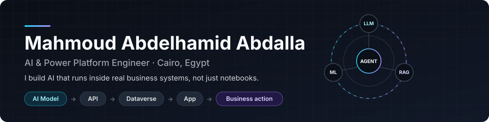

  
  
  

## About

I'm an AI Engineer working hands-on across two areas that rarely sit in one person: **Generative AI & predictive ML** on one side, **Microsoft Power Platform & Azure** on the other.

A model on its own is not a solution. What I care about is the system around it: where the prediction is stored, who sees it, which business rule acts on it, and whether a human reviews it before anything happens. That's why I build the whole path, from the model to the API, the Dataverse record, the app and the automated business action.

## What I work on

<table>
<tr>
<td width="33%" valign="top">

**🤖 Generative AI**

Multi-agent systems with LangGraph (routing, parallel tools, self-correction loops, safety checks), RAG with FAISS and Gemini, and document AI that turns PDFs and scans into verified, structured data.

</td>
<td width="33%" valign="top">

**📈 Predictive maintenance ML**

Anomaly detection and fault classification (Isolation Forest, LightGBM, LSTM) combined with physics rule engines and EWMA dynamic thresholds, served on Azure Functions.

</td>
<td width="33%" valign="top">

**🟪 Microsoft Power Platform**

Dataverse data models, pro-code Code Apps (React + TypeScript), Model-Driven and Canvas apps, Power Pages, PCF controls, C# plugins, Power Automate and ALM with PAC CLI.

</td>
</tr>
</table>

## Professional work

Most of my production work lives in private client repositories, so here is what it covers:

- **Enterprise asset-management & predictive-maintenance platform** (AI & Power Platform Engineer, Germany, remote · 2025–present): lead builder across a Power Apps Code App, Model-Driven and Canvas apps and a Power Pages portal on Dataverse, with PCF controls, C# plugins and Entra ID role-based multi-tenancy. Built the AI layer behind it: predictive-maintenance models on Azure Functions, a RAG assistant over equipment manuals, and a document-AI service on Azure Container Apps.
- **Conversational AI & automation for SaaS products** (AI Engineer, Australia, remote · 2025–2026): client-facing chatbots and voice agents, and the design of an AI automation builder with an adapter-based execution engine.

## 🚧 Currently building: Masar (مسار)

An Arabic, agent-assisted platform for processing government-service applications: document extraction, completeness and regulation checks, routing to the right department, SLA tracking, and human approval for exceptions. Built on Dataverse (plug-ins, Custom API, PCF, ALM) with Azure AI, using synthetic data only. I'm sharing the build week by week on [LinkedIn](https://www.linkedin.com/in/mahmoud-abdelhamid-abdalla-0a340a249/); the repository goes public in early 2027.

## Open-source projects

<table>
<tr>
<td width="50%" valign="top">

### [📰 AI Pulse](https://github.com/mahmoudabdalla26/ai-pulse)
Self-correcting multi-agent news digest. Agents collect, rank, summarize and fact-check AI/tech news, an editor agent revises the result, and a GitHub Actions schedule delivers it to Telegram.

`LangGraph` `Gemini` `Tavily` `GitHub Actions`

</td>
<td width="50%" valign="top">

### [🩺 Balance Sugar Chatbot](https://github.com/mahmoudabdalla26/balance-sugar-chatbot)
Bilingual (Arabic/English) diabetes assistant on a supervised multi-agent RAG. A supervisor routes each question to parallel tools (knowledge base, user history, web search, medical calculator) and a safety node checks every answer.

`LangGraph` `LangChain` `FastAPI` `Gemini`

</td>
</tr>
<tr>
<td width="50%" valign="top">

### [⚙️ AI Automation Builder](https://github.com/mahmoudabdalla26/ai-automation-builder)
FastAPI backend that turns a plain-language idea into a structured AI automation workflow through a multi-agent Gemini pipeline.

`FastAPI` `Gemini` `Python`

</td>
<td width="50%" valign="top">

### [✍️ Agentic Content Engine](https://github.com/mahmoudabdalla26/Agentic-Content-Engine)
Multi-agent LinkedIn content pipeline: three specialized Gemini agents running in sequence, with a Next.js front end. [Live demo](https://agentic-content-engine.vercel.app)

`Next.js` `TypeScript` `Gemini`

</td>
</tr>
<tr>
<td width="50%" valign="top">

### [🛒 AmzRecEngine](https://github.com/mahmoudabdalla26/AmzRecEngine)
Hybrid recommender for Amazon software products: collaborative filtering (SVD), content-based (TF-IDF) and FAISS vector similarity, served through a Flask API.

`FAISS` `scikit-learn` `Flask`

</td>
<td width="50%" valign="top">

### [🧹 LLM Data Quality Filtering](https://github.com/mahmoudabdalla26/LLM-Data-Quality-Filtering)
Experiment comparing a fastText quality classifier with perplexity scoring for filtering LLM pre-training text.

`fastText` `NLP` `Python`

</td>
</tr>
</table>

## Tech stack

**AI & ML** 

**Microsoft & Azure** 

**Backend & tools** 

## Education & certifications

- **B.Sc. Computers & Informatics (Medical Informatics)**, Zagazig University · Excellent with Honors
- Machine Learning Specialization · Stanford Online / DeepLearning.AI
- Certified Data Science Professional · Epsilon AI Institute
- Google Data Analytics Professional Certificate

## Writing

I write in Arabic and English on LinkedIn about building AI-powered enterprise systems: where AI belongs in an architecture, Dataverse as a business data layer, human-in-the-loop design, and document AI in production. [Follow along →](https://www.linkedin.com/in/mahmoud-abdelhamid-abdalla-0a340a249/recent-activity/all/)
